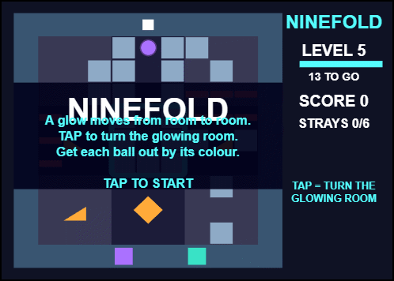
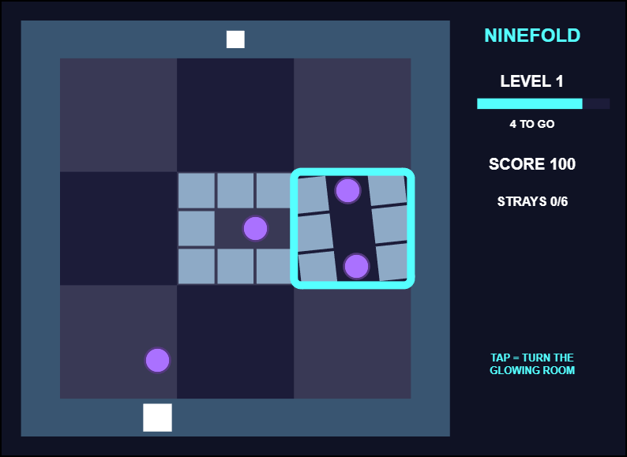
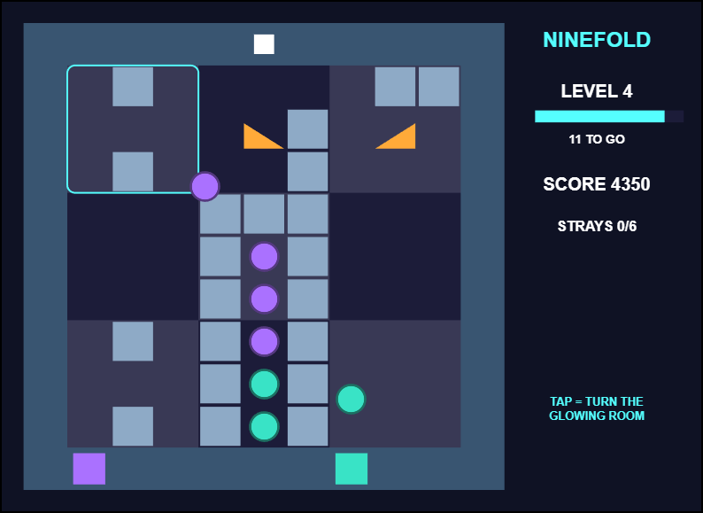
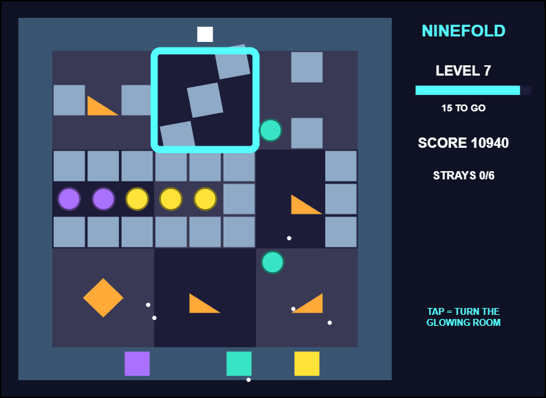
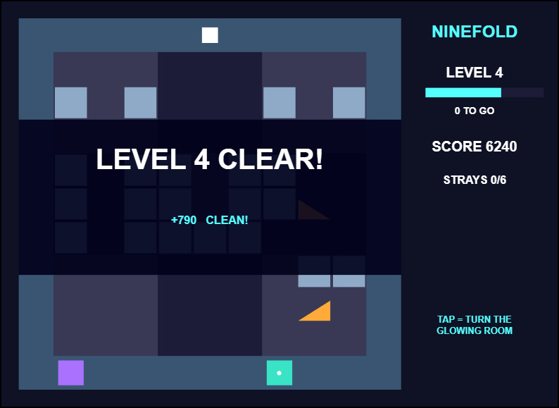
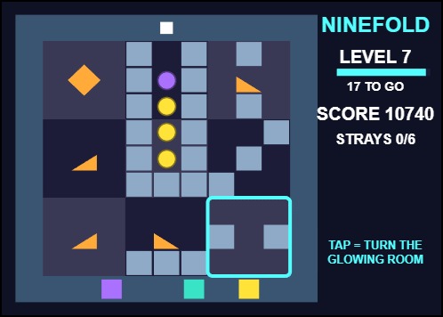
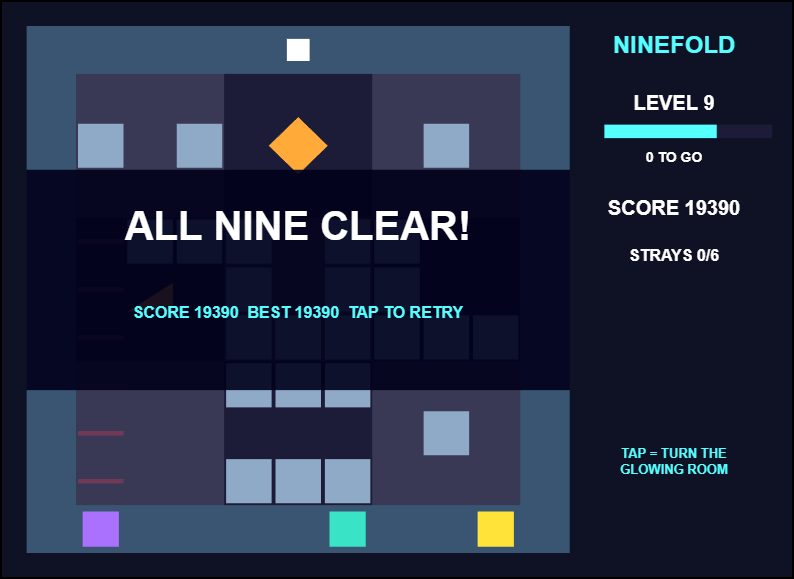

# matlab-obg-gen

*Describe a one-button game. Get a contest entry.*

[matlab-obg-gen](https://github.com/zeveck/matlab-obg-gen) is a [Claude Code](https://claude.com/claude-code) plugin for the [MATLAB One-Button Game Mini Hack](https://www.mathworks.com/matlabcentral/contests/matlab-one-button-game-mini-hack.html). Describe the game you want, and it designs it, has review agents poke holes in the design, writes it as a single `game.m` under the contest's 10,000-character limit, plays it in MATLAB with scripted taps and bots, **proves every level can be beaten by a person**, and tells you when it's ready to try. When you're happy, it submits it for you.

```
/matlab-obg-gen <describe your game>
```



This is the whole request that [Ninefold](#example-ninefold) was made from:

> /matlab-obg-gen Let's make a game where colored balls are trying to flow through a system of traps/pipes/seesaws/etc. the play area is divided into nine subareas. you can tap to rotate the whole screen or you can tap to rotate individual subareas. the idea it's a realtime puzzle game, kinda like the physical Perplexity toy, but with a lot going on and your interface is just the ability to rotate the room, subareas, and perhaps flip switches, toggle buttons, and whatnot, to control the flow, and your goal is to get all the balls through without any straggers. maybe there's a timer? and any left over balls count against your score? It should probably have a series of levels in increasing difficulty? it'd be great if it could generate more levels, but we only have so much code to work with!

## Contents

- [Make a game](#make-a-game)
  - [Change, continue, ideas](#change-continue-ideas)
  - [Submit it](#submit-it)
- [What you get](#what-you-get)
- [Install](#install)
  - [What it needs (and sets up for you)](#what-it-needs-and-sets-up-for-you)
- [How it works](#how-it-works)
  - [Every level proven beatable](#every-level-proven-beatable)
- [Tips](#tips)
- [Example: Ninefold](#example-ninefold)
- [Development](#development)
- [License](#license)

## Make a game

Once it's [installed](#install), open Claude Code in your contest project folder (the [starter project](https://www.mathworks.com/matlabcentral/fileexchange/185098-matlab-one-button-game-minihack-starter-project), unzipped) and describe your game:

```
/matlab-obg-gen <describe your game>
```

Then let it work. It first checks that MATLAB and the tools it needs are ready (and helps you set up anything missing), then posts a short update after each step. A game takes a while: design and review, building in stages, and a lot of play-testing. Press Esc to stop it at any time.

The more of your idea you describe, the more of it ends up in the game. A short idea works too; it fills in the rest in the same spirit. Every game must work with **one button**: the contest gives a game nothing but "the button was tapped this frame" (no mouse position, no holding), so the interesting part is what a tap means and *when* you press it.

| Option | What it does | Default |
|---|---|---|
| `--rounds <1 to 3>` | Rounds of design review | `1` |
| `--plan-only` | Stop after the reviewed design, so you can read it first | off |

### Change, continue, ideas

```
/matlab-obg-gen ideas 5 puzzle        # five one-button concepts to choose from (no building)
/matlab-obg-gen --change ninefold make the glow a little faster
/matlab-obg-gen --continue            # pick up an interrupted game
/matlab-obg-gen setup                 # just check (and fix) your setup
/matlab-obg-gen help
```

`--change` keeps everything you didn't mention, then re-runs every check, including the proof that every level can still be beaten.

### Submit it

```
/matlab-obg-gen --submit ninefold
```

It won't submit anything unless the game passes everything first: every level's proof, the contest's own validation (character count, banned functions), the play-test suite, and a look at the first frame (that's your gallery thumbnail). Then it asks you for a title and an explicit go-ahead in one question, because submitting is public under your MathWorks account. After submitting it records the entry's link and refreshes your draft **Tips & Tricks post**, which the contest requires for its grand prizes and Most Played award; you post that yourself in the contest's Discussions channel.

## What you get

Each game gets its own folder, `games/<name>/`:

- `game.m`: the entry, ready for `minihackContest.play` and `minihackContest.submit`.
- `README.md`: how to play it and what's inside.
- `design/`: the brief, the design, the review log, a progress file (`STATUS.md`), a draft Tips & Tricks post, the test scripts, screenshots and GIFs, and `solutions/`: a recorded, replayable solution for every level.

To play it in MATLAB:

```matlab
cd games/ninefold
minihackContest.play
```

## Install

In Claude Code:

```
/plugin install matlab-obg-gen --marketplace zeveck/matlab-obg-gen
```

Run `/reload-plugins` (or restart Claude Code), and `/matlab-obg-gen` is ready. To keep it current, turn on auto-update: `/plugin` → Marketplaces → matlab-obg-gen → Enable auto-update.

To remove it:

```
claude plugin uninstall matlab-obg-gen@matlab-obg-gen
```

### What it needs (and sets up for you)

At the start of every run it checks for these and walks you through anything missing, doing as much of it as it can itself:

- **MATLAB R2021a or later** (MATLAB only, no toolboxes). Installing it needs your MathWorks account, so you sign in and activate; it can do the download and install for you (into a folder that doesn't need admin rights) and repair a known path problem with that kind of install.
- **The MATLAB connection for Claude**: MathWorks' [MATLAB Agentic Toolkit](https://github.com/matlab/matlab-agentic-toolkit) and its MCP server, so Claude can run your game, test it and take screenshots. It installs and configures this; you restart Claude Code once.
- **The contest's starter project** ([File Exchange #185098](https://www.mathworks.com/matlabcentral/fileexchange/185098-matlab-one-button-game-minihack-starter-project)): the download needs your sign-in, so you unzip it into your folder; opening it installs the contest's `minihackContest` tools.
- **Some free memory.** Each MATLAB it runs uses about 1.5-2 GB, so it checks how busy your machine is before running tests and runs them one at a time when memory is tight.

The setup check is a Windows PowerShell script for now; on macOS and Linux it checks the same things by hand.

## How it works

1. **Brief:** what you asked for, as a checklist in your own words, so nothing gets lost.
2. **Design:** what a tap means and why that's clever, the first five seconds (the gallery thumbnail), the difficulty curve, the levels, the look, and a budget in *counted* characters.
3. **Design review:** three independent reviewers (a player, a MATLAB builder, a contest judge) look for problems before any code exists.
4. **Build** in stages, validating against the contest's live rules and measuring the character count from the first stage. (The contest counts code *after* MATLAB re-spaces it, which comes out about 1.5x what it looks like; the skill knows the tricks for fitting.)
5. **Play-test** headlessly in MATLAB: idling, mashing, random tapping, a skilled bot, dying and restarting, frame timing and screenshots of every screen.
6. **Final review** by a fresh playtester and a bug hunter, then a **polish pass** by a reviewer who never saw the game being made.
7. **Wrap up:** the README, the Tips & Tricks draft, and a short report.

### Every level proven beatable

This is the rule that matters most: a level that can't be beaten is worse than no level at all. For every level:

- a **solver** (a search over taps, using the game's own code) finds a way to clear it completely, with nothing lost, and the solution is saved;
- a **human-timing player** (reaction times of 65-265 ms, re-deciding from what it actually sees) must clear it too, because a frame-perfect machine solution isn't proof a person can do it;
- a full run, from the title screen to the ending, is replayed through the contest's own harness;
- all of it re-runs after every change (`design/tests/prove.m`), and `--submit` refuses unless it passes.

Generated levels are allowed only as a fixed set of seeds that have each been proven this way. No endless levels that nobody has checked.

## Tips

- **Describe the feel, not just the rules.** "A real-time puzzle with a lot going on" shaped Ninefold as much as its mechanics did.
- **Think about what one tap means.** Pointing is impossible, so selection has to come from timing (a cursor that moves, a rhythm, a count of taps). If a scheme feels wrong when you play it, say so; Ninefold's glow got slower, steadier and skippable from exactly that feedback.
- **Play it and react.** The first version is a strong draft. `--change` is cheap, and every change re-proves the levels.
- **Close the game window between changes.** A running `minihackContest.play` window keeps the old version.

## Example: Ninefold

*Nine rooms, nine levels, one button: turn the glowing room to pour every ball home.*

Coloured balls drip into a box of nine rooms full of cups, shelves, seesaws and trap doors. A glow moves from room to room and then around the whole box; tap to turn whatever is glowing a quarter turn. Every ball has to leave through a hole of its own colour before the clock runs out. 9,903 / 10,000 characters, with all nine levels proven beatable with human timing.

| | |
|---|---|
|  |  |
|  |  |





The game, its design notes, review log, solver and recorded solutions are in [examples/ninefold](examples/ninefold).

## Development

Run the checks with `node --test`. The plugin lives in `skills/`: the skill is `skills/matlab-obg-gen/SKILL.md`, with the detail for each step in `skills/matlab-obg-gen/references/` and the MATLAB test harness in `skills/matlab-obg-gen/tools/`. See [CLAUDE.md](CLAUDE.md) for working on the plugin itself.

## License

MIT. See [LICENSE](LICENSE). Not affiliated with MathWorks; MATLAB is a registered trademark of The MathWorks, Inc.
